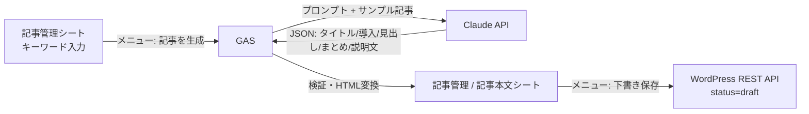

# GAS × Claude API × WordPress SEOブログ記事自動生成システム

Googleスプレッドシートに入力したキーワードから、Claude API で SEO ブログ記事（2,000〜3,000文字）を生成し、
スプレッドシートへ保存、必要に応じて WordPress に **下書き** として保存するシステムです。

> AI開発講座 案件2 ポートフォリオ作品

## 特長

| 項目 | 内容 |
|---|---|
| 操作 | スプレッドシートのカスタムメニュー「記事生成」から実行。コード操作は不要 |
| 記事構成 | タイトル／導入／H2見出し×3／まとめ。本文2,000〜3,000文字、メタディスクリプション120文字以内 |
| 品質チェック | 文字数・見出し数・説明文長を自動検証し、仕様外なら指摘を添えて自動で書き直し（最大2回） |
| プロンプト | 具体的な業務場面・実行できる手順・検索意図に答える見出しを指示（v2）。サービス紹介は関連時のみ控えめに、確定情報以外の機能・料金は書かせない。`PROMPT_VERSION=v1` で改善前と比較可能 |
| 文体 | 「サンプル記事」シートの記事を文体の参考として渡し、25文字以上の一致（丸写し）を自動検知 |
| WordPress | REST API で **下書き（draft）のみ** 保存。自動公開のコードは存在しない |
| WordPressなしでも利用可 | 記事はスプレッドシートに保存されるため、WordPress未接続でもそのまま使える |
| 二重実行防止 | ロック＋ステータス管理で二重生成を防止。投稿前にスラッグ検索して二重投稿を防止 |
| エラー対策 | レート制限（429）・過負荷（529/5xx）の自動再試行、認証エラーの即時停止、GAS 6分制限の管理、1記事あたりAPI呼び出し4回までの上限 |
| コスト管理 | 既定は低価格の Claude Haiku 5.5。1記事ごとのトークン数・API呼び出し回数・推定費用（USD）を記録 |
| セキュリティ | APIキー・WordPress認証情報は Script Properties のみに保存。シート・ログ・画面に値を出さない |

## 処理の流れ



## ステータス

`未生成` → `生成中` → `生成済み` → `投稿中` → `下書き保存済み`
（失敗時は `生成エラー` / `投稿エラー`。どちらも再実行で回復できます。書き直しても文字数などの必須条件を満たさない記事は `要確認` になり、人が確認するまで WordPress へは保存されません）

## 実装・検証状況（2026-11-18）

| 項目 | 状態 |
|---|---|
| ローカルモックテスト | ✅ 162件すべて成功 |
| GAS への配置（clasp） | ✅ 配置済み。GAS 上の13ファイルとローカルの一致を確認 |
| Claude API での記事生成（実環境） | ✅ 正式5テーマを生成（OK 3本・注意 1本・要確認 1本、5本で約 $0.021） |
| WordPress への下書き保存（実環境） | ✅ テスト用 WordPress で確認（接続・アプリケーションパスワード認証・下書き保存・投稿ID/URLの記録） |
| 二重投稿の防止（実環境） | ✅ 同じ記事の再投稿が `INVALID_STATE` で拒否されることを確認 |
| WordPress での公開 | 対象外（システムは下書きまで。公開は人が行う） |
| 異常系の実環境テスト（誤ったAPIキーなど）・Sonnet との比較 | ⬜ 未実施 |
| 法令を扱う記事の内容確認（有給休暇・36協定） | ⬜ 人による公的資料での確認が未完了 |

納品条件ごとの状況は [納品チェックリスト](docs/10-delivery-checklist.md) を参照してください。

## フォルダ構成

```
gas-ai-blog-generator/
├─ src/                    … GAS にアップロードするコード
│  ├─ appsscript.json      … マニフェスト（タイムゾーン・権限）
│  ├─ Menu.js              … onOpen とメニュー操作（画面とのやり取りはここだけ）
│  ├─ Generator.js         … 記事生成の本体（行の確保・再生成・一括処理・リセット）
│  ├─ Publisher.js         … WordPress 下書き保存の本体
│  ├─ ClaudeClient.js      … Claude Messages API 呼び出しと応答解析
│  ├─ WordPressClient.js   … WordPress REST API 呼び出し（draft 固定）
│  ├─ HttpClient.js        … リトライ・レート制限・認証エラー・時間制限の共通処理
│  ├─ PromptBuilder.js     … プロンプトと出力 JSON Schema
│  ├─ ArticleFormatter.js  … 記事の検証、Markdown / HTML 変換、丸写し検知
│  ├─ SheetRepository.js   … スプレッドシートの読み書き
│  ├─ Setup.js             … シート初期化、テスト用キーワード、ダミーサンプル記事
│  ├─ Config.js            … 定数と Script Properties の読み込み
│  └─ Utils.js             … 共通関数
├─ test/                   … ローカルで動くモックテスト（Node.js 標準のみ）
├─ scripts/setup-clasp.js  … .clasp.json（スクリプトID）をGit管理外に作成
├─ samples/                … テスト用キーワード、サンプル記事の置き場所
├─ docs/                   … 各種ドキュメント
├─ .clasp.json.example     … clasp を使う場合の設定例
└─ package.json
```

## ドキュメント

| ドキュメント | 内容 |
|---|---|
| [APIキー設定手順書](docs/01-api-key-setup.md) | Claude APIキー・WordPressアプリケーションパスワードの取得と Script Properties への登録 |
| [利用マニュアル](docs/02-user-manual.md) | 初心者向けの導入・操作手順 |
| [トラブルシューティング](docs/03-troubleshooting.md) | エラー表示ごとの原因と対処 |
| [テスト手順・結果](docs/04-testing.md) | ローカルテストと実環境テストの手順・結果 |
| [技術構成図](docs/05-architecture.md) | 構成図、シート設計、シーケンス、設計判断 |
| [振り返り](docs/06-retrospective.md) | 工夫した点・課題・今後の改善 |
| [clasp 配置手順](docs/07-clasp-deploy.md) | clasp で既存の Apps Script プロジェクトへ送信する手順と注意点 |
| [プロンプト改善](docs/08-prompt-improvement.md) | プロンプト v1 → v2 の改善内容と、改善前後の比較手順 |
| [法令情報の正確性と公開判断](docs/09-legal-accuracy.md) | 正式5テーマのテストで見つかった課題、法令情報の扱い方、公開前の確認の進め方、修正案 |
| [納品チェックリスト](docs/10-delivery-checklist.md) | 納品条件ごとの完了・未完了と、GitHub 公開までの残作業 |

## クイックスタート

1. Googleスプレッドシートを新規作成し、「拡張機能 > Apps Script」を開く
2. `src/` 配下の `.js` ファイルと `appsscript.json` の内容をエディタにコピー（または clasp で push：[手順](docs/07-clasp-deploy.md)）
3. Script Properties に `CLAUDE_API_KEY` を登録（[手順書](docs/01-api-key-setup.md)）
4. スプレッドシートを再読み込み → メニュー「記事生成 > 初期設定 > シートを初期化」
5. 「初期設定 > テスト用キーワードを追加」→ 行を選択 →「選択行の記事を生成」

## ローカルテスト

Google・Claude・WordPress には接続せず、GAS のサービスをモックして動作を確認します（外部ライブラリ不要）。

```bash
npm test
```

`npm test` は外部ライブラリなしで動きます。clasp の送信対象チェックは `npm install` 後に自動で有効になります。

## 使用技術

- Google Apps Script（V8ランタイム）／ Google スプレッドシート
- Claude API（Messages API、structured outputs、既定モデル `claude-haiku-5-5`。品質重視時は `claude-sonnet-5-5` に切替可）
- WordPress REST API（アプリケーションパスワード認証）
- Node.js 標準テストランナー（`node:test`）によるモックテスト
