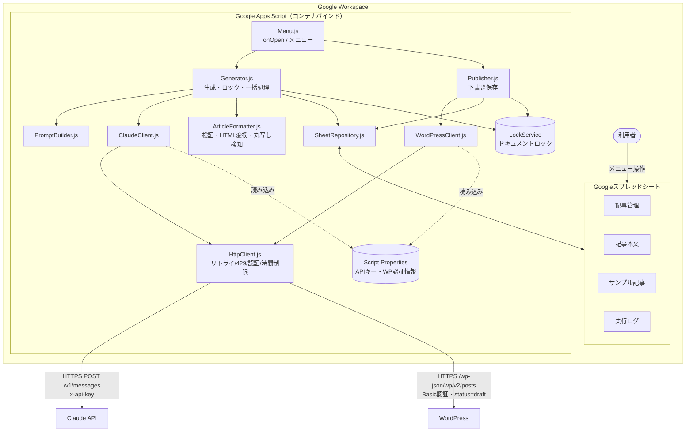
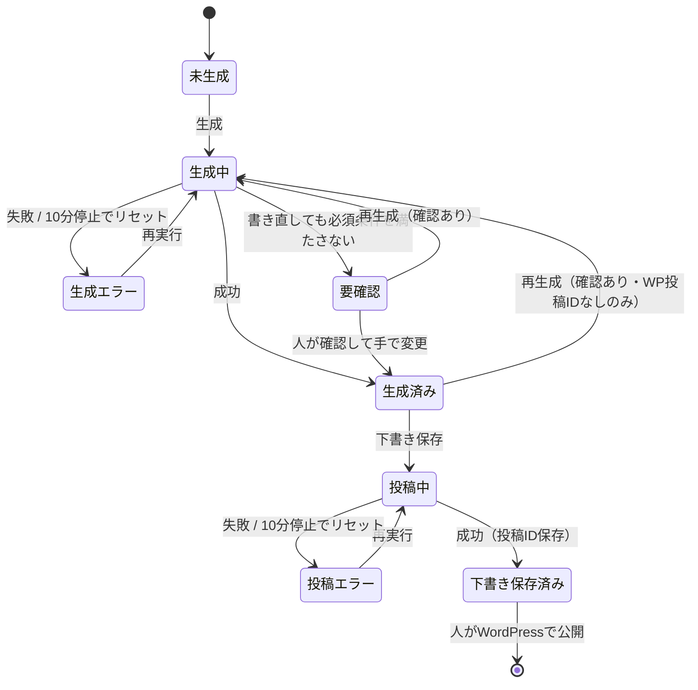
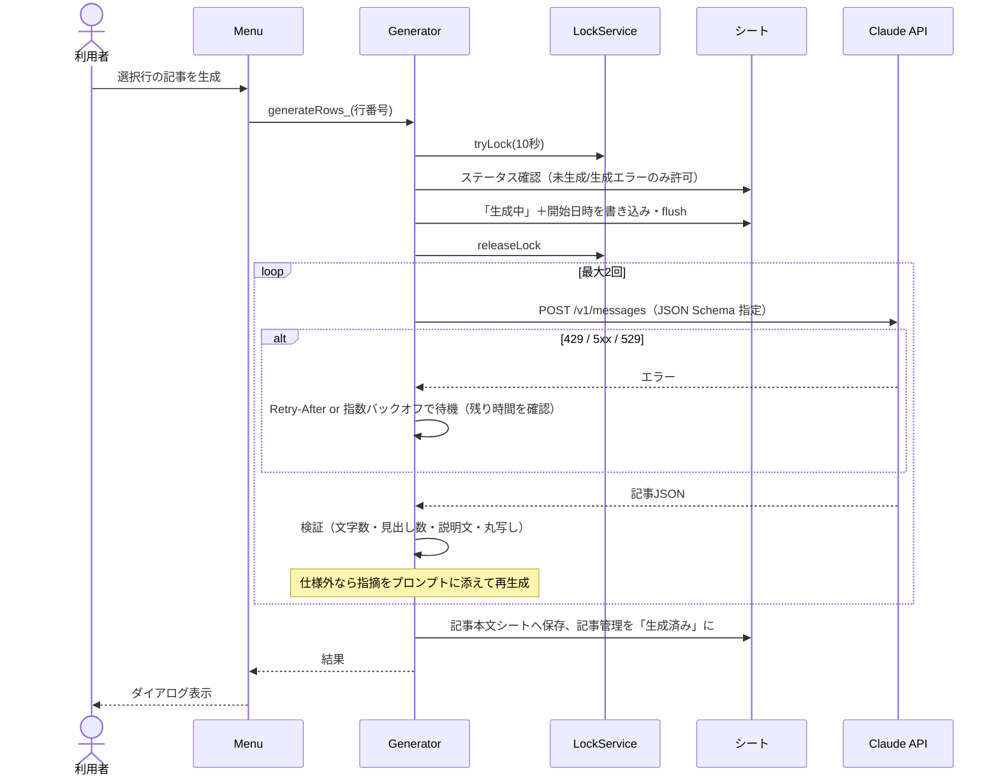

# 技術構成図

## 1. システム構成

### レイヤーの考え方
- **画面（Menu.js）** だけが `SpreadsheetApp.getUi()` を使う。他は UI に依存しないので、ローカルでテストできる
- **外部通信（HttpClient.js）** にリトライ・レート制限・認証エラー・時間制限の判断を集約し、Claude と WordPress で共有
- **シート構造（Config.js / SheetRepository.js）** 以外は列番号を知らない。列変更の影響範囲を限定

## 2. シート設計

### 記事管理（1行＝1記事）

| 列 | 項目 | 入力者 | 説明 |
|---|---|---|---|
| A | ID | 自動 | `KW-001` 形式。WordPress のスラッグ（`aiblog-kw-001`）にも使用 |
| B | キーワード | 利用者 | 必須 |
| C | サブキーワード | 利用者 | 任意、カンマ区切り |
| D | ステータス | 自動 | 入力規則つきプルダウン |
| E | タイトル | 自動 | |
| F | メタディスクリプション | 自動 | 120文字以内 |
| G | 文字数 | 自動 | 導入＋見出し＋本文＋まとめ（空白・改行・記号を除く） |
| H | WordPress投稿ID | 自動 | 二重投稿防止のキー |
| I | WordPress URL | 自動 | 下書きの編集画面URL |
| J | 処理結果 | 自動 | `OK：…` / `注意：…`（仕様は満たすが確認点あり）/ `要確認：…`（必須条件を満たさない）/ `[エラーコード] …` |
| K | 処理開始日時 | 自動 | 停止判定（10分）に使用 |
| L | 最終更新日時 | 自動 | |
| M | 生成回数 | 自動 | 再生成の回数（コスト把握用） |

### 記事本文（1行＝1記事、IDで記事管理と対応）
ID / キーワード / タイトル / 本文（Markdown）/ 本文（HTML）/ メタディスクリプション / 生成日時 / モデル / 入力トークン / 出力トークン / API呼び出し回数 / 推定費用（USD）

> トークン数は書き直し分を含む1記事の合計（HTTP 200 の応答＝課金対象のみ集計）。推定費用は `MODEL_PROFILES` の単価から計算。失敗時の使用量は「実行ログ」に残す。

> 本文を別シートに分けた理由：記事管理シートを一覧として見やすく保つため。セル上限（5万文字）にも十分収まる。

### サンプル記事
サンプルID / タイトル / 本文 / 利用する（TRUE/FALSE）/ メモ — `TRUE` の記事（最大2本）を文体参考としてプロンプトに含める。

### 実行ログ
日時 / ID / 処理 / 結果 / 詳細 — 秘密情報はマスクして記録。

## 3. ステータス遷移

## 4. 記事生成のシーケンス

## 5. 主な設計判断

| 課題 | 対策 |
|---|---|
| 二重生成 | ドキュメントロック内で「ステータス確認→処理中に変更」を一気に行う。生成済みは専用メニュー＋確認ダイアログでのみ上書き |
| 二重投稿 | ① WP投稿IDがある行は投稿不可 ② 投稿前に固定スラッグで WordPress を検索し、既存があれば紐付け ③ 投稿作成リクエストは5xx・通信エラーで自動再送しない |
| 自動公開の禁止 | `status` は定数 `'draft'` のみ。送信直前にも検査。応答が draft 以外なら警告。テストで `publish` 文字列の不在を確認 |
| GAS 6分制限 | 4分30秒を上限に、1記事あたり2分の見込みが残っていなければ着手しない。再試行の待機も残り時間内に限定。API呼び出しは残り45秒未満なら開始しない |
| リトライの長時間化・課金膨張 | 1記事あたりのAPI呼び出しを4回（書き直し＋HTTP再試行の合計）に制限。書き直しは「残り2分以上」かつ「呼び出し枠あり」のときだけ。書き直しが失敗しても1回目の記事は保存 |
| 処理の中断 | 「処理開始日時」から10分経過した処理中ステータスを停止とみなし、再開・リセット可能に |
| レート制限 | 429 は `Retry-After` に従い、5xx/529 は指数バックオフ＋ジッター（最大3回、最大30秒） |
| 認証エラー | 再試行しない。一括処理では残りを中止（全件同じ結果になるため） |
| 出力形式の安定 | Claude の structured outputs（JSON Schema）で形式を固定し、コード側でも必須項目を検証 |
| 文字数・説明文の仕様 | 違反時は具体的な指摘を添えて書き直し。最後まで説明文が長ければ句点で切り詰め |
| 丸写し防止 | プロンプトで禁止＋サンプルと25文字以上一致する箇所を検出して「注意」 |
| 仕様外の記事の扱い | 書き直しても文字数・見出し数・説明文長を満たさない記事は、試行の中で最も条件に近いものを保存し、ステータス「要確認」にする。下書き保存の対象（生成済み・投稿エラー）に含めないため、人が確認するまで WordPress に送られない |
| 秘密情報 | Script Properties のみ。エラーメッセージ内のキーやBasic認証値はマスク。設定確認画面は「設定済み／未設定」のみ |
| WordPress未接続 | 未設定ならスキップ（エラーにしない）。生成・保存は単独で完結 |
| Claude の応答拒否 | `stop_reason: refusal` を検出。サーバー側フォールバック（`fallbacks: "default"`）は対応モデル（Sonnet 5.5 / Opus 5.5）でのみ送信。Haiku 5.5 は非対応のため送らない |
| モデル選択 | 既定は低価格の Haiku 5.5。`CLAUDE_MODEL` だけで Sonnet 5.5 等に切り替え可能（構造化出力・検証・書き直しはモデル共通） |

## 6. Claude API 呼び出し仕様

| 項目 | 値 |
|---|---|
| エンドポイント | `POST https://api.anthropic.com/v1/messages` |
| ヘッダー | `x-api-key`、`anthropic-version: 2026-10-21`、`anthropic-beta: server-side-fallback-2026-07-01`（フォールバック対応モデルのみ） |
| モデル | `claude-haiku-5-5`（`CLAUDE_MODEL` で `claude-sonnet-5-5` などに変更可） |
| max_tokens | 16000 |
| output_config | `effort: medium`、`format: { type: json_schema, schema: ARTICLE_SCHEMA }` |
| 送らないもの | `temperature` 等のサンプリングパラメータ（現行APIでは400エラー）、`thinking`（省略時は adaptive thinking）、Haiku 5.5 への `fallbacks` |

### モデル別の対応状況（2026-11 時点の公式仕様で確認）

| 機能 | Haiku 5.5 | Sonnet 5.5 | 本システムでの扱い |
|---|---|---|---|
| 構造化出力（`output_config.format` JSON Schema） | ✅ | ✅ | 共通で使用。スキーマは非対応制約（min/max系）を使わない |
| effort（low〜max） | ✅ 既定 medium | ✅ 既定 high | 明示的に `medium` を送る |
| サーバー側フォールバック | ❌ | ✅ | 対応モデルのみ送信 |
| 応答拒否 `stop_reason: refusal` | あり | あり | 共通で検出・エラー表示 |
| 文字数チェック・書き直し | — | — | モデルに依存しない（コード側で実施） |

GAS には公式SDKがないため、REST API を `UrlFetchApp` で直接呼び出しています。
